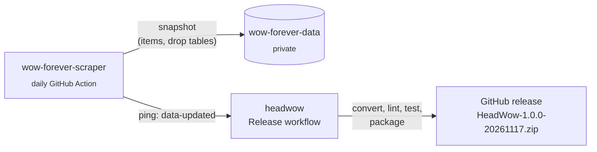

<p align="center">
  
</p>

<h1 align="center">HeadWow</h1>

<p align="center">
  <b>Wowhead's WoW Forever database, inside the game.</b><br>
  Every item, every NPC, who drops what and how often, where to farm it, and what it's worth.
</p>

<p align="center">
  <a href="https://github.com/lauridskern/headwow/releases/latest"></a>
  <a href="https://github.com/lauridskern/headwow/actions/workflows/release.yml"></a>
  <a href="https://github.com/lauridskern/headwow/actions/workflows/ci.yml"></a>
  
</p>

---

HeadWow bundles a fresh snapshot of [Wowhead's WoW Forever](https://www.wowhead.com/forever/) database (25,000+ items, 4,600+ NPCs, 6,900 drop tables) and puts it a click away: search it, see drop chances, find the best camp to farm an item, rank mobs by what their loot sells for, and pin it all on the world map. A new release with the latest data comes out every day.

## Features

**Browse**: search items and NPCs by name or ID, with filters for quality, source, slot, and your character (usable by your class, your armor type, your level, NPCs near your level). The home page has shortcuts, what you looked at lately, and tips.

**Item pages**: the game's own tooltip, how to get the item, the best places to farm it and who drops it most often, plus full *Dropped by* and *Where to farm* tables. Vendor and auction prices in the header.

**NPC pages**: level, title and what a kill is worth; a 3D model you can turn; every zone it lives in with its densest camp; its loot table with each drop's chance and value per kill.

**Where to farm**: zones ranked by the drops to expect from one clear of their best *camp*, the densest ~225-yard patch of spawns (a loop you can actually run, not a whole zone), with every NPC that drops the item counted together.

**Gold farming**: mobs a few levels (or many) below you, ranked by what their drops sell for, per kill and per camp clear. Hover a mob to see where the value comes from.

**Wishlist**: star the items you're after. Mobs that drop them list them first in their tooltips, can be pinned on the map, and you get a raid warning and a sound when one drops.

**World map**: *Show on map* pins every spawn of the mobs that drop an item, ringed by drop chance, with a banner naming the best place to farm. NPC pages pin their own spawns.

**Everywhere else**: mob tooltips show their notable drops; item tooltips show who drops them; Alt-click any item (bags, chat, loot) to open it in HeadWow; a minimap button; a page in the game's Settings.

### Better with

HeadWow works on its own; these addons make it better when they're installed:

| Addon | What it adds |
|---|---|
| [Questie](https://github.com/Questie/Questie) | NPC levels and spawn points (via its QuestieDB), which power camps, spawn pins, gold farming and the level filters |
| [Auctionator](https://www.curseforge.com/wow/addons/auctionator) | AH prices. HeadWow only trusts an item with a steady market: the median of the daily lows, listed on at least half of your scan days in the last two weeks and still listed lately. A one-off listing never counts. |
| OpenMap | Pins on its stitched world map, and a toggle in its menu |
| EasyFind | HeadWow's drop sources on EasyFind's item pages, NPC portraits in its results, and an extension tile |

## Install

1. Download the zip from the [latest release](https://github.com/lauridskern/headwow/releases/latest).
2. Extract it into `World of Warcraft/_forever_/Interface/AddOns/`. It holds two folders: `HeadWow` (the addon, items and NPCs) and `HeadWow_Drops` (the drop tables, loaded when first needed).
3. Restart the game. Open HeadWow with `/hw`, the minimap button or the addon compartment.

To update, do the same with a newer release, replacing both folders.

## Commands

| Command | |
|---|---|
| `/hw [search]` | Open or close HeadWow, or open it with a search |
| `/hw gold` | Gold farming |
| `/hw wish [item]` | The wishlist, or star / unstar an item |
| `/hw map <item>` | Show where an item drops on the world map |
| `/hw map` | Show or hide the tracked item's pins |
| `/hw tooltip` | Drop sources in item tooltips on or off |
| `/hw minimap` | Minimap button on or off |
| `/hw config` | Settings |

## Daily releases



1. [wow-forever-scraper](https://github.com/lauridskern/wow-forever-scraper) scrapes Wowhead every day and commits the snapshot to the private `wow-forever-data` repo.
2. When it's done, it pings this repo (`repository_dispatch: data-updated`). A check every 6 hours catches a missed ping.
3. The [Release workflow](.github/workflows/release.yml) compares the snapshot and `VERSION` with the latest release. If either changed, it converts the snapshot to Lua, lints and tests everything, packages both addons and publishes a release. Its notes show the counts and what changed since the last one: new items, NPCs and drop tables, and the addon's own commits.

Versions are `VERSION` plus the snapshot's date: `1.0.0-20261117`. A second release on the same day gets `.2`. Bumping `VERSION` on `master` releases right away; *Actions > Release > Run workflow* releases by hand, and its *force* option releases even when nothing changed.

The workflow reads the private data repo with a read-only deploy key, stored here as the secret `DATA_DEPLOY_KEY`. The scraper finds this repo through its `ADDON_REPO` secret.

## How the numbers work

- **Drop chance** and **kills**: Wowhead's, from players running its client. Items with very long drop tables are cut short on Wowhead; the item page says how many sources are missing.
- **Camp**: the densest block of a mob's spawn points, 3×3 cells of 75 yards. Spawn points come from QuestieDB.
- **Per clear**: drops (or gold) to expect from killing every spawn in the camp once: chance × spawns, summed over the mobs there.
- **Per kill (gold)**: each drop's chance × its price: the vendor price, or the AH median minus the 5% cut when the item has a steady market.
- **Not counted**: coin, skinning and gathering, kill speed and respawn times. None of them is in any data HeadWow has.

## Development

Needs Node 20+ and a clone of the data repo next to this one.

```sh
npm ci
npm run data       # convert ../wow-forever-data into HeadWow*/Generated/*.lua
npm run check      # lint + tests
npm run package    # dist/HeadWow, dist/HeadWow_Drops and a zip
```

For a dev install, link (or copy) `HeadWow` and `HeadWow_Drops` into the game's `AddOns` folder. Adding or removing files needs a game restart; edits only need `/reload`.

**Tests** run without the game (`tests/run.mjs`, Lua in [fengari](https://github.com/fengari-lua/fengari)):
- *logic*: the data modules (search filters, camps, where to farm, wishlist, gold values, AH market rules) against a tiny snapshot, with hand-checked numbers.
- *smoke*: the whole addon, loaded in TOC order into a mock client (`tests/mock/wow.lua`). It opens every view, clicks and hovers every row, card, tab, menu entry and button, runs the slash commands, map pins, tooltips and loot alert, and fails on any Lua error.

**Lint** (`tools/lint.mjs`) checks that every Lua file parses as Lua 5.1, that every XML file is well-formed, and that no local function is used above its definition.

### Layout

```
HeadWow/                core addon: items and NPCs (~1.7 MB of data)
  Core.lua              namespace, data access, prices, saved variables, slash commands
  Search.lua            item search and filters
  NPC.lua               NPCs: levels and spawns (QuestieDB), camps, loot, portraits, hover card
  Farm.lua              where to farm an item
  Wishlist.lua          wishlist, notable loot, loot alert
  GoldFarm.lua          gold farming values
  Map.lua               world map pins and banner (Blizzard's map and OpenMap)
  Integration.lua       item and mob tooltips, Alt-click
  EasyFind.lua          EasyFind integration
  UI/                   the window: shell, Browse / item / NPC pages, Wishlist, Gold farming,
                        shared widgets, settings, minimap button, XML templates
HeadWow_Drops/          drop tables (~2.5 MB), loaded on demand
tools/                  convert (snapshot -> Lua), lint, package, release notes
tests/                  logic and smoke tests, the mock client
.github/workflows/      CI and the daily release
```

## Credits

Data from [Wowhead](https://www.wowhead.com/forever/); NPC levels and spawn points from [Questie](https://github.com/Questie/Questie)'s database when it's installed. HeadWow isn't affiliated with Wowhead or Blizzard Entertainment.
